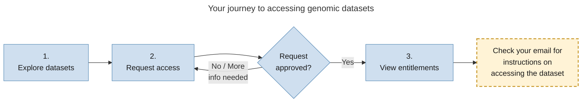

# How the Data Portal works

This page explains the process of finding genomic datasets and getting access to them.

## Your journey to accessing datasets

The journey to accessing genomic datasets follows a simple path: 1) you find a dataset, 2) you request access, and 3) you follow the instructions to access the data once your request is approved.

:::note External datasets

This process does not apply to datasets labelled as `External datasets`.
Some datasets in the portal are maintained by organisations outside of GDI and are labelled as `External datasets`. To access them, follow the links to their external websites.

:::

## Access genomic datasets in three steps

Follow these steps to discover, request, and access genomic datasets.

1. **[Explore datasets](/category/explore-datasets/):** Browse and search through detailed dataset information—search by any criteria such as keywords, research topics, disease areas, or allele frequency.

2. **[Request access](/category/request-datasets/):** Found a dataset you want to use? Submit an application to access it. You may need to provide documentation or requirements for your request, and you can invite collaborators to assist you with your application. If your application needs changes or additional information, you can update and resubmit it.

3. **[View approved datasets (entitlements)](/view-entitlements):** Once your request is approved, they appear in the **Entitlements** tab of the Data Portal, and you will receive a notification via email. Follow the instructions in the email to access the data. Typically, this access is facilitated through a secure processing environment (SPE).

   :::info Stay compliant

   All data are protected by governance frameworks and data access policies to ensure ethical and legal use. Remember to **use data responsibly** and according to the terms and agreements you signed during the application process.

   :::
